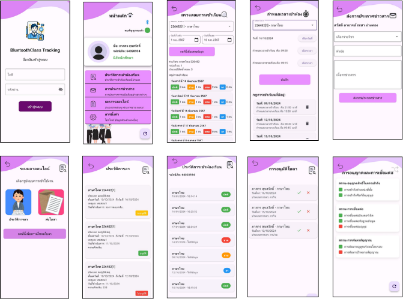

# Repository : Images for App

<p align="center">
  <b>Project Images & Contact Assets</b><br>
  คลังรูปภาพ ไอคอน GIF และ QR Code สำหรับนำไปอ้างอิงในแอปพลิเคชันและหน้ารวบรวมผลงาน
</p>

---

## About Repository

images_for_app เป็น repository สำหรับรวบรวมไฟล์ภาพไว้ในตำแหน่งกลาง เพื่อให้นำไปใช้ประกอบแอป หน้าเว็บ Portfolio หรือ README ได้สะดวก

ไฟล์ภายในแบ่งเป็นภาพที่เกี่ยวข้องกับโปรเจกต์และไอคอนในโฟลเดอร์ `assets` กับภาพช่องทางติดต่อในโฟลเดอร์ `contact` โดยมีทั้ง PNG, JPEG และ GIF รวมถึง QR Code แยกไว้อีกชั้นหนึ่ง

Repository นี้เป็นคลังไฟล์สื่อ จึงไม่มีตัวแอป Source Code สำหรับรัน หรือขั้นตอน Build ของตนเอง วิธีใช้งานหลักคือเลือกภาพที่ตรงกับเนื้อหา แล้วอ้างอิงไฟล์ในเครื่องหรือผ่าน Raw URL

---

## Asset Collections

### Project Images & Icons

โฟลเดอร์ `assets` เก็บไฟล์ภาพหลายกลุ่ม โดยชื่อไฟล์ช่วยแยกประเภทและโปรเจกต์ที่เกี่ยวข้อง เช่น:

| กลุ่มไฟล์ตามชื่อ | ตัวอย่าง |
|---|---|
| Class Tracking | `class_tracking.png`, `class_tracking_page.png` |
| WPF / Automation / Back Office | `wpfIcon.png`, `wpf_page.png`, `automationIcon.png`, `backofficeIcon.png` |
| Police Care / OnePolice | `policecareicon.png`, `policecare_page.png`, `onepoliceicon.png`, `onepolice_page.png` |
| ภาพ Screenshot | `screenshort_police_care_01.png`, `screenshort_police_care_02.png` |
| กิจกรรมและโปรเจกต์อื่น | `eventPoliceCareIcon.png`, `popularVoteIcon.png`, `tesaTopgunIcon.png` |
| ภาพข้อมูลและโปรไฟล์ | `info_app01.png`, `profile.png` |

ควรเปิดตรวจภาพก่อนเลือกใช้ เพราะชื่อไฟล์เป็นตัวช่วยค้นหา และภาพประกอบควรตรงกับโปรเจกต์ที่กำลังอธิบาย

### Contact Images

โฟลเดอร์ `contact` มีภาพไอคอนสำหรับแสดงช่องทางติดต่อ เช่น GitHub, Gmail, LINE, LinkedIn และโทรศัพท์ พร้อมไฟล์ GIF ชื่อ `contact.gif` และ `qrcode_scan.gif`

### QR Codes

โฟลเดอร์ `contact/qrcode` เก็บภาพ QR Code แยกตามชื่อช่องทาง:

- `github_qrcode.png`
- `line_qrcode.jpg`
- `linkedin_qrcode.png`

ก่อนนำไปเผยแพร่ควรตรวจปลายทางของ QR Code ที่เลือกให้ตรงกับช่องทางที่ต้องการแสดง

---

## Project Structure

```text
images_for_app/
├── assets/                 # ภาพและไอคอนของโปรเจกต์
├── contact/
│   ├── contact.gif
│   ├── qrcode_scan.gif
│   ├── github_icon.png
│   ├── gmail_icon.png
│   ├── line_icon.png
│   ├── linkedin_logo.jpeg
│   ├── phone_icon.png
│   └── qrcode/             # QR Code ช่องทางติดต่อ
└── README.md
```

ชื่อไฟล์บางรายการใช้ตัวพิมพ์ใหญ่ผสมเล็ก และคำว่า `screenshort` ตามที่เก็บอยู่จริง จึงต้องใช้ Path ให้ตรงทุกตัวอักษรเมื่ออ้างอิง

---

## Supported File Types

| รูปแบบไฟล์ | ไฟล์ตัวอย่างใน repository |
|---|---|
| PNG | ไอคอน ภาพโปรเจกต์ และ QR Code หลายรายการ |
| JPEG / JPG | `linkedin_logo.jpeg` และ `line_qrcode.jpg` |
| GIF | `contact.gif` และ `qrcode_scan.gif` |

ไม่มี Backend หรือบริการ API สำหรับจัดการไฟล์ใน repository นี้ การเข้าถึงผ่าน URL เป็นการเรียกไฟล์ที่อยู่บน GitHub

---

## Usage Examples

### Reference from a README in This Repository

หากเขียน Markdown ที่รากของ repository สามารถใช้ Relative Path ได้:

```markdown

```

ตัวอย่างนี้เป็นข้อความแสดงวิธีเขียน Markdown จึงยังไม่ได้แทรกภาพจริงใน README ฉบับนี้

### Reference from Another Repository or Website

ใช้ Raw URL ที่ระบุชื่อไฟล์จริง เช่น:

```text
https://raw.githubusercontent.com/kittanai46/images_for_app/main/assets/class_tracking_page.png
```

ตัวอย่าง Markdown สำหรับอ้างอิงจากภายนอก:

```markdown

```

หากต้องการกำหนดความกว้างใน README สามารถใช้ HTML:

```html
<p align="center">
  
</p>
```

### Use in Flutter

สามารถโหลดภาพที่ต้องการผ่าน Network URL:

```dart
Image.network(
  'https://raw.githubusercontent.com/kittanai46/images_for_app/main/assets/class_tracking_page.png',
  fit: BoxFit.contain,
)
```

หรือคัดลอกภาพเข้าโปรเจกต์ Flutter ของตนเอง ประกาศ Path ใน `pubspec.yaml` แล้วใช้ `Image.asset()` หากต้องการรวมไฟล์ไปกับแอป

---

## Getting Started

```bash
git clone https://github.com/kittanai46/images_for_app.git
cd images_for_app
```

เปิดเลือกไฟล์จาก `assets` หรือ `contact` ได้ทันที โดยไม่ต้องติดตั้ง Dependency หรือรันคำสั่ง Build

---

## Maintenance Notes

- เลือกไฟล์ให้สื่อถึงโปรเจกต์หรือช่องทางติดต่อที่กำลังนำเสนอ
- ใช้ชื่อไฟล์และนามสกุลตรงกับรายการจริง รวมถึงตัวพิมพ์ใหญ่และเล็ก
- ลิงก์ที่อ้าง `main` จะอ่านไฟล์จาก Branch นั้น การเปลี่ยนชื่อหรือลบไฟล์จะกระทบผู้ที่ใช้ URL เดิม
- หากเพิ่มสื่อชุดใหม่ ควรตั้งชื่อให้สื่อความหมายและจัดไว้ในโฟลเดอร์ที่ตรงกับประเภท

---

## Repository Owner

[Kittanai Srikham](https://github.com/kittanai46)

